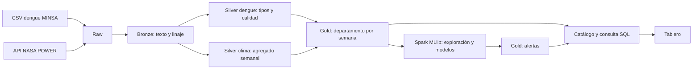

# Predicción de brotes de dengue en Perú con datos epidemiológicos y climáticos

Proyecto académico de Big Data y Analítica de Datos, Ingeniería de Computación y Sistemas, Universidad Privada Antenor Orrego, periodo 2026-20. Grupo 13. 
Docente: Ing. Armando Javier Caballero Alvarado.

**Resultado actual:** el pipeline funciona y la logística obtiene AUC-ROC 0.922 con casos y clima, pero el clima no mejora al modelo de casos solos (0.928). Al evaluar únicamente semanas sin brote vigente, el AUC baja a 0.689 con clima frente a 0.710 con casos solos. El objetivo predictivo de anticipación todavía requiere mejoras; no se presenta el AUC global como prueba suficiente de alerta temprana.

## Equipo y alcance

| Integrante | Responsabilidad |
|---|---|
| Arenas Arriaga, Johan Michael | Coordinación, análisis y modelado |
| Campos Acevedo, Gianfranco | Ingeniería de datos, calidad y documentación |

Ruta de despliegue: **Ruta B (nube, AWS)**. El parcial se presentó como Ruta A (on-premise local con Docker y Spark); el cambio de ruta está en curso y debe quedar aprobado por el docente y registrado en la bitácora del informe. Mientras tanto, todos los resultados de este README provienen de la ejecución local. Se procesa el registro nacional 2000–2024 y se modelan 19 departamentos con al menos 1 000 registros en el periodo, que concentran aproximadamente el 99.93 % de casos. El informe declara un acuerdo de alcance con el docente en Semana 2; su respaldo documental sigue pendiente de incorporar. Los roles dobles y la cantidad de commits no sustituyen evidencia de planificación, contribuciones y decisiones.

Es un prototipo académico, no un servicio oficial del MINSA ni una herramienta validada para decisiones sanitarias.

## Problema y objetivo

Estimar por departamento y semana epidemiológica si habrá al menos una semana de brote en las cuatro siguientes. La referencia de negocio del informe es la detección cuando los casos superan el canal endémico; la supuesta anticipación actual de cero semanas necesita respaldo y no constituye una medición institucional realizada por este proyecto.

La meta inicial fue AUC-ROC > 0.80. Se alcanza en prueba completa, pero no en semanas sin brote vigente, que se acercan más a la pregunta de anticipación. La evaluación debe contrastarse con referencias simples, prevalencia, falsas alarmas y estabilidad temporal; no solo con superar 0.80.

## Fuentes y granularidad

| Fuente | Periodo | Datos originales |
|---|---|---|
| Vigilancia epidemiológica de dengue, CDC Perú / MINSA | 2000–2024 | 1 029 421 registros, 14 columnas, CSV separado por `;`, aproximadamente 103.5 MB |
| NASA POWER, API diaria | 2000–2024 | 19 puntos, 9 132 días por punto; temperatura T2M, humedad RH2M y precipitación PRECTOTCORR |

Dengue: [Plataforma Nacional de Datos Abiertos](https://www.datosabiertos.gob.pe/dataset/vigilancia-epidemiol%C3%B3gica-de-dengue). Clima: `https://power.larc.nasa.gov/api/temporal/daily/point`.

La auditoría de las respuestas climáticas encontró cero valores de relleno `-999`, pero solo 17 series distintas: Amazonas/Cajamarca y Lima/Callao tienen series exactamente iguales. Un punto por departamento no representa todos sus focos; la resolución espacial limita la señal. No se demuestra que estas limitaciones expliquen por sí solas el resultado del modelo.

## Arquitectura

La arquitectura lógica es medallion (Raw, Bronze, Silver y Gold) y no cambia entre rutas. El modelo se entrena con Spark MLlib.



| Pieza | Implementado hoy (local) | Ruta B objetivo (AWS) |
|---|---|---|
| Almacenamiento | Disco local montado en Docker | Amazon S3, privado y cifrado |
| Procesamiento | Spark 3.5 en modo `local[2]` | Spark en un clúster Amazon EMR |
| Modelo | Spark MLlib | Spark MLlib en EMR, modelos versionados en S3 |
| Catálogo | — | AWS Glue Data Catalog |
| Consulta | — | Amazon Athena |
| Tablero | — | QuickSight o Streamlit sobre Athena |
| Desarrollo | JupyterLab en Docker | Se mantiene en local |

El diseño completo de la Ruta B, con diagramas, seguridad, costo estimado y requisitos, está en [diagrama_ruta_b.md](diagrama_ruta_b.md). La alternativa on-premise (HDFS y YARN) se conserva como respaldo en [diagrama.md](diagrama.md).

| Capa | Ruta bajo `data/` | Contrato |
|---|---|---|
| Raw | `raw/` | CSV dengue y respuestas originales NASA; no se modifican en el pipeline |
| Bronze | `bronze/` | Texto sin inferencia de tipos y metadatos `_archivo_origen`, `_fecha_ingesta`; Parquet |
| Silver | `silver/` | Dengue tipado, particionado por año, rechazados con motivo; clima semanal; Parquet |
| Gold | `gold/panel_dengue_clima/` | Una fila por departamento/año/semana; conteo cero en semanas sin casos; Parquet |

Gold contiene exactamente `cod_dep`, `departamento`, `ano`, `semana`, `casos`, `temp_media`, `hum_media`, `precip_total`. Su clave es departamento/año/semana. En la ejecución validada hay **24 776 filas**. El notebook `modeloBase` depende de este esquema, no de registros individuales.

Hoy el almacenamiento es disco local montado en Docker y Spark se ejecuta en modo local: todavía no hay S3, EMR, catálogo gestionado ni clúster multinodo. La reconstrucción desde Raw permite recuperar datos, pero no acredita alta disponibilidad. Migrar a S3 y EMR requiere adaptar rutas, sesión de Spark, credenciales y accesos; no basta con afirmar la sustitución sin validarla. Parquet y el esquema Gold reducen el acoplamiento entre componentes.

### Calidad y privacidad

Se normalizan textos y ubigeos, tipan años y semanas, validan diagnóstico, sexo, edad y calendario; se separan rechazados con motivo. La semana 53 solo se admite en años epidemiológicos que la tienen. Las filas idénticas se conservan porque, sin identificador de caso, pueden representar pacientes distintos.

En clima, `-999` y valores fuera de rangos físicos se convierten en nulos; se agregan semanas con siete días. Ambos conjuntos usan semanas de domingo a sábado, con semana 1 que contiene el 4 de enero. Gold verifica número de filas, conservación de casos y ausencia de clima nulo en los controles implementados.

Los datos individuales permanecen fuera de Git; Silver descarta localidad, localcod y diresa, pero conserva otros atributos individuales. Gold solo contiene agregados. No se afirma anonimización absoluta ni se ha realizado una auditoría formal de reidentificación. El informe cita la Ley N.º 29733; la conformidad legal no queda demostrada por descartar columnas. No hay controles productivos de cifrado/autorización acreditados por este repositorio.

## Instalación y reproducción

Requisitos: Docker Desktop/Engine con Compose v2, Python 3.10+ en el host (o `uv` para los comandos del supervisor), aproximadamente 8 GB de RAM disponibles para el entorno, espacio libre para originales y capas, e internet en la primera descarga climática. El crecimiento de réplicas consume espacio adicional.

```bash
git clone https://github.com/JhonTMich/minsadengue-bigdata.git
cd minsadengue-bigdata
docker compose up -d
docker compose logs pyspark-notebook
```

Jupyter: `http://localhost:8888`. Spark UI: `http://localhost:4040` mientras exista una sesión activa. La imagen se fija por digest `jupyter/pyspark-notebook@sha256:58377aaa152b741e244f201679f96d909a024ea337088cc276b0ee32ab3f076f`; las mediciones registradas usan Spark 3.5.0 y Python 3.11.6. El supervisor de escalabilidad resuelve la misma imagen declarada en Compose.

1. Guardar el CSV como `data/raw/datos_abiertos_vigilancia_dengue_2000_2024.csv`.
2. Ejecutar `notebooks/cargaDatos.ipynb` completo. NASA se descarga y se reutilizan archivos existentes.
3. Ejecutar `notebooks/modeloBase.ipynb` completo después de obtener Gold.

El modelo requiere Gold; no existe actualmente lectura alternativa de una muestra CSV implementada. Las capas se sobrescriben: no ejecutar mediciones del pipeline en paralelo ni mientras se consulta la misma salida.

### Despliegue en AWS (Ruta B, en preparación)

Todavía no hay ejecución en la nube. Los requisitos previstos son una cuenta de AWS (Learner Lab de AWS Academy o cuenta propia con alerta de presupuesto), AWS CLI con credenciales temporales fuera del repositorio, un bucket S3 privado y roles de IAM para EMR. Los pasos de despliegue y las evidencias se agregarán a esta sección cuando el pipeline se ejecute en EMR. Ver [diagrama_ruta_b.md](diagrama_ruta_b.md).

### Ejecuciones automáticas y evidencias

```bash
docker compose exec -T pyspark-notebook python /home/jovyan/work/scripts/medir_optimizacion.py
docker compose exec -T pyspark-notebook python /home/jovyan/work/scripts/resumir_optimizacion.py
docker compose exec -T pyspark-notebook python /home/jovyan/work/scripts/evaluar_aporte_clima.py
docker compose exec -T pyspark-notebook python /home/jovyan/work/scripts/resumir_aporte_clima.py
docker compose exec -T pyspark-notebook python /home/jovyan/work/scripts/validar_clima_temporal.py --train-end 2014 --valid-end 2019
```

Los notebooks ejecutados quedan en `output/`, ignorado por Git. Métricas y probabilidades agregadas quedan en `data/metricas/`. Los CSV de resultados y protocolos sin datos personales se conservan en `docs/evidencias/` para versionado. No hace falta consultar otro documento para interpretar los resultados principales incluidos abajo.

## Rendimiento medido: caché y particiones

Se ejecutaron cuatro configuraciones, tres repeticiones cada una, con kernel nuevo, orden aleatorio de semilla 42, Spark `local[2]` y driver configurado en 4 GB. Docker informó 12 CPU y aproximadamente 7.3 GiB de RAM. Se varió la caché de Bronze; la caché del clima se mantuvo igual. La caché del SO no se controló.

| Caché Bronze | Shuffle configurado | Mediana (s) | Mínimo (s) | Máximo (s) |
|---|---:|---:|---:|---:|
| No | 8 | 26.52 | 26.16 | 32.80 |
| No | 200 | 29.92 | 28.45 | 36.01 |
| Sí | 8 | 31.06 | 29.54 | 39.69 |
| Sí | 200 | 32.39 | 26.58 | 33.36 |

Ocho particiones sin caché produjo una mediana 11.4 % menor que 200 sin caché. La caché aumentó la mediana 17.1 % con ocho particiones y 8.3 % con 200: no se sostiene su beneficio aquí. El valor predeterminado pasó a `USAR_CACHE=False`, con `SHUFFLE_PARTITIONS=8`. Los rangos se solapan; tres corridas no prueban una ventaja universal ni significancia estadística.

`TOTAL` suma siete etapas instrumentadas, no el tiempo completo: excluye arranque, descarga climática y parte de los controles. Las particiones configuradas no equivalen necesariamente al número de tareas efectivo de todas las etapas.

## Escalabilidad: alcance y límites

La sección 3.7 de la guía exige ×10 y ×100 sobre el pipeline completo con tiempos y recursos. La sección 7 del notebook remite al ejecutor del host, para evitar lanzar réplicas masivas con «Run All».

```bash
uv run python scripts/ejecutar_escalabilidad.py
uv run python scripts/resumir_escalabilidad.py
```

El primer comando ejecuta ×1, ×10 y ×100 secuencialmente. Cada factor usa un contenedor independiente de dos CPU y 4 GiB, sin swap del contenedor, Spark local[2] y driver de 2 GB. El timeout predeterminado es de 1800 segundos por factor, incluida la generación del CSV, y se exige reserva de disco. Los temporales de Spark se ubican en el volumen del proyecto para evitar llenar el disco del motor Docker; el worker reserva 8 GiB en ese volumen y el supervisor actualizado detiene la prueba si C: baja de 2 GiB en Windows. La imagen se resuelve a su identificador exacto y se registra. Se pueden elegir factores con `--factores 1 10 100` y timeout con `--timeout 1800`. `--reuse-raw` reutiliza un CSV previamente generado si coinciden tamaño y cabecera; los conteos y casos escalados se validan igualmente al terminar. Los resultados anteriores se archivan antes de repetir un factor.

La réplica crece solo en registros de dengue; el clima permanece como fuente de referencia de tamaño fijo, evitando duplicar sus claves y multiplicar casos durante el join. Se leen los CSV, escriben Bronze, aplican controles y transformaciones Silver de ambas fuentes, y escriben y validan Gold. Se escala el umbral de selección de departamentos por el factor para mantener los mismos 19 departamentos. Se comprueba el conteo de registros y que los casos Gold sean los originales multiplicados por el factor.

Las salidas quedan en `data/escalabilidad_completa/x<factor>/` y nunca alimentan el modelo ni sobrescriben las capas canónicas. `estado.json` indica etapa/resultado; `supervision.json` registra límites, imagen, salida, timeout y OOM. El monitoreo de cgroup registra memoria y CPU; la memoria de cgroup puede incluir caché y no equivale al heap JVM. Se admiten cgroup v1 y v2. Las métricas de spill/shuffle corresponden a etapas completas de la aplicación Spark, incluidos controles de referencia. Spill de memoria es volumen acumulado derramado, no el pico de RAM. Los logs se guardan en `output/escalabilidad_completa/`.

El límite de RAM es del contenedor, no de todo el equipo. Si falla, se conserva la evidencia y se detienen las escalas siguientes de esa ejecución. Un intento fallido no se presenta como ejecución completada ni satisface automáticamente el requisito: debe contrastarse con el docente. El timeout es un presupuesto del experimento, no un punto de quiebre físico demostrado. No se usa ordenamiento aleatorio, que añadiría trabajo sin eliminar los duplicados.

La medición parcial anterior cubría Silver y construcción/conteo Gold, sin ingesta ni escritura Gold: no sirve como ejecución completa de la sección 3.7. Como referencia histórica, aquella validación ×1 procesó 1 029 421 registros: **5.5 s** para transformación Silver y construcción/conteo Gold, Bronze físico 4.9 MB, Silver 2.9 MB, shuffle reportado 0.1 MB, spill de memoria/disco 0 y pico de ejecución por etapa 271.6 MB. Este pico no representa RAM total del equipo o proceso. Una métrica ausente se escribe nula, no cero.

Generar y contar las réplicas ocurre antes de medir; la entrada está recién escrita/leída y la caché del SO favorece el I/O. Copias idénticas se comprimen mucho. Por tanto, los tiempos antiguos de ×100 no acreditan escalabilidad multinodo ni necesidad de clúster. El conjunto original cabe en una máquina; la necesidad de procesamiento distribuido y el punto de quiebre todavía no están demostrados.

<!-- escalabilidad-resultados:inicio -->
### Resultados del pipeline completo

Una corrida por escala, con dos CPU, 4 GiB de límite de contenedor, heap de driver de 2 GB y temporales en E:. Se reutilizaron los CSV ya generados: la preparación reutilizada no se interpreta como tiempo de generación. La generación inicial del CSV ×100 tomó 207 s y produjo 10.86 GB; ese intento se interrumpió antes de Silver para trasladar los temporales de C: a E:, sin OOM ni timeout. Su motivo y métricas se conservaron por separado.

| Factor | Estado | Registros dengue | Pipeline (s) | Tiempo relativo | Pico cgroup (GiB) | Spill memoria (MB) | Spill disco (MB) | Shuffle escrito (MB) |
|---|---|---:|---:|---:|---:|---:|---:|---:|
| 1 | completado | 1029421 | 64.98 | 1.00 | 1.22 | 0.00 | 0.00 | 67.03 |
| 10 | completado | 10294210 | 142.95 | 2.20 | 2.38 | 805.31 | 93.60 | 322.98 |
| 100 | completado | 102942100 | 1188.52 | 18.29 | 2.52 | 17951.61 | 2176.90 | 2633.79 |

| Factor | Raw CSV (GB) | Bronze (MB) | Silver (MB) | Gold (MB) |
|---|---:|---:|---:|---:|
| 1 | 0.11 | 6.12 | 3.24 | 0.19 |
| 10 | 1.09 | 46.32 | 29.43 | 0.19 |
| 100 | 10.86 | 446.01 | 322.68 | 0.19 |

| Etapa cronometrada | ×1 (s) | ×10 (s) | ×100 (s) |
|---|---:|---:|---:|
| bronze_dengue | 11.61 | 43.28 | 351.54 |
| bronze_clima | 2.49 | 2.32 | 2.15 |
| dengue_calidad | 13.00 | 27.32 | 178.06 |
| dengue_silver_escritura | 14.64 | 49.45 | 623.24 |
| clima_calidad | 2.79 | 1.92 | 1.44 |
| clima_silver_escritura | 2.15 | 1.38 | 1.11 |
| gold_escritura | 6.61 | 6.54 | 12.01 |

Estas etapas parciales no suman el tiempo completo: el pipeline incluye controles y acciones adicionales fuera de sus cronómetros. La salida de rechazados usa coalesce(1), observada como una sola tarea en ×100; su tiempo forma parte de dengue_silver_escritura. No se cambió esta lógica durante la corrida.

El tiempo de pipeline incluye ingesta de los CSV de dengue y clima, escritura Bronze/Silver/Gold y controles internos. Excluye generar la réplica, arrancar Spark y la comprobación independiente contra Gold canónico. Las métricas Spark incluyen también esa comprobación. El pico cgroup incluye memoria fuera del heap y puede incluir caché; para un intento fallido solo hay pico hasta el último muestreo, no necesariamente el pico final. Spill de memoria es volumen acumulado, no RAM instantánea.

El presupuesto inicial fue 1200 s por factor. En ×100 se amplió a 1800 s por progreso sostenido y recursos estables, retomando solo la supervisión: no se reinició Spark ni se reinició el reloj del pipeline. El supervisor actualizado usa 1800 s por defecto.

El aumento del volumen solo corresponde a dengue: clima y cardinalidad de Gold permanecen fijos. Las réplicas idénticas favorecen compresión y agregaciones; la caché del SO no se controla. Una corrida no estima variabilidad ni demuestra escalabilidad multinodo. No se deben comparar estos tiempos con los 5.5 s del experimento parcial ni con la suma de etapas del benchmark de optimización, que usan otro alcance y configuración.

Las tres escalas terminaron sin OOM ni timeout; cada Gold tiene 24 776 filas y conserva los casos originales multiplicados por el factor. Se ejecutaron las escalas ×10 y ×100 solicitadas, con los límites de esta metodología. No se observó un fallo de capacidad hasta ×100: el spill demuestra presión de memoria, no que la máquina haya dejado de alcanzar. No hay evidencia suficiente para fijar un punto de quiebre exacto o afirmar que ya se necesita un clúster.

La evidencia numérica y los protocolos quedan en `docs/evidencias/escalabilidad_completa/`; los datos replicados permanecen fuera de Git y del modelado.
<!-- escalabilidad-resultados:fin -->

## Modelo, etiquetas y referencias

Brote: casos superiores al Q3 de la misma semana en los cinco años previos, con mínimo de cinco casos. La semana 53 usa como referencia histórica la 52. Etiqueta positiva: al menos una semana de brote en las siguientes cuatro; sin horizonte completo, no se asigna etiqueta.

Entrenamiento original 2005–2019; prueba 2021–2024. El año 2020 no se incluye como fila de entrenamiento/prueba, aunque el protocolo original no garantiza excluirlo de todas las ventanas históricas o desenlaces próximos a los límites. Las nuevas validaciones aplican embargo explícito. Se usan logaritmo de casos actuales, rezago de una semana, brote actual y anomalías de temperatura, humedad y precipitación en ventanas 0–3, 4–7 y 8–11 semanas. Las logísticas usan escalado y ponderaciones de clase ajustadas en entrenamiento.

La prueba completa tiene 3 876 filas etiquetadas y prevalencia 67.23 %. Sin brote actual hay 1 647 filas y 449 positivas (27.26 %). Son semanas departamentales, no episodios independientes: las ventanas se solapan. Ninguna fila etiquetada se perdió por predictores nulos; las 76 filas finales sin etiqueta se excluyen por horizonte incompleto.

| Referencia/modelo, prueba completa | AUC-ROC | AUC-PR Spark | Precisión | Recall |
|---|---:|---:|---:|---:|
| Siempre brote | 0.500 | 0.672 | 0.672 | 1.000 |
| Persistencia | 0.886 | 0.942 | 0.968 | 0.828 |
| Logística: casos | 0.928 | 0.964 | 0.796 | 0.955 |
| Logística: casos + clima | 0.922 | 0.962 | 0.782 | 0.958 |
| Logística: clima | 0.577 | 0.745 | 0.689 | 0.527 |

La mayoría en entrenamiento es negativa: su regla constante acierta 32.8 % en prueba. «Siempre brote» es una referencia distinta, que acierta 67.2 %. La persistencia acierta 86.6 %, frente a 79.2 % de casos + clima al umbral 0.5. La prevalencia afecta especialmente precisión, exactitud y referencia PR; no explica automáticamente el AUC-ROC.

### Evaluación de semanas sin brote vigente

| Logística | AUC-ROC | Average precision | Precisión a 0.5 | Recall a 0.5 | VP | FP |
|---|---:|---:|---:|---:|---:|---:|
| Casos | 0.7103 | 0.4435 | 0.3708 | 0.7416 | 333 | 565 |
| Casos + clima | 0.6889 | 0.4330 | 0.3524 | 0.7550 | 339 | 623 |
| Clima | 0.5182 | 0.2667 | 0.2608 | 0.4566 | 205 | 581 |

Agregar clima detecta seis semanas positivas más, pero genera 58 falsas alarmas adicionales. No se demuestra beneficio operativo. La persistencia siempre predice cero en este subconjunto; superarla no es suficiente. El ranking de casos actuales sin modelo ya alcanza AUC 0.704. Para ese ranking no se aplican métricas de clasificación con umbral arbitrario 0.5.

`average_precision` usa sklearn y no coincide exactamente con el área PR interpolada de Spark. No deben mezclarse ambos cálculos en una misma comparación. Los umbrales siguen fijos en 0.5; no se comparó a igual recall ni se establecieron costos institucionales de error.

| Año sin brote vigente | AUC casos | AUC casos + clima |
|---|---:|---:|
| 2021 | 0.7072 | 0.7130 |
| 2022 | 0.8288 | 0.8317 |
| 2023 | 0.6217 | 0.6019 |
| 2024 | 0.7121 | 0.6877 |

La señal cambia con el tiempo. Estos resultados no demuestran que el clima carezca de relación con dengue: no aporta mejora consistente con esta representación, modelo y periodo.

## Validación exploratoria de otra representación climática

Se entrenó con 2005–2014 y validó con 2015–2019. Se recortaron datos posteriores a 2019 antes de construir etiquetas, se excluyeron cuatro semanas finales de entrenamiento y se calculó climatología solo hasta 2014. Se compararon seis modelos sobre las mismas 4 864 filas. Las variables absolutas son promedios de temperatura, humedad y precipitación semanal en las mismas tres ventanas causales.

| Algoritmo, semanas sin brote actual | Variables | AUC-ROC | Average precision |
|---|---|---:|---:|
| Logística | Casos | 0.7587 | 0.2644 |
| Logística | Casos + anomalías | 0.7650 | 0.2798 |
| Logística | Casos + anomalías + niveles absolutos | 0.7730 | 0.3207 |
| Random Forest | Casos | 0.7581 | 0.2619 |
| Random Forest | Casos + anomalías | 0.7568 | 0.2810 |
| Random Forest | Casos + anomalías + niveles absolutos | 0.7484 | 0.2344 |

RF usa 50 árboles, profundidad 5 y semilla 42; logística maxIter=100. No se buscaron hiperparámetros ni se calibró el umbral. Este primer corte sugiere investigar niveles absolutos para logística; cambiar a árboles no resolvió automáticamente el problema.

## Estabilidad en tres bloques temporales

Entrenamientos expansivos 2005–2010, 2005–2014 y 2005–2017; validaciones no solapadas 2011–2014, 2015–2017 y 2018–2019. Cada corte recalcula climatología solo con entrenamiento, aplica embargo de cuatro semanas al final de entrenamiento y excluye las cuatro semanas finales de validación sin desenlace completo. Se ejecutaron 18 modelos, sin búsqueda de hiperparámetros ni ajuste del umbral.

A continuación se comparan casos solos con casos más anomalías y niveles absolutos, únicamente en semanas sin brote vigente.

| Validación | Algoritmo | AUC casos | AUC con clima absoluto | AP casos | AP con clima absoluto |
|---|---|---:|---:|---:|---:|
| 2011–2014 | logistica | 0.8496 | 0.8416 | 0.4719 | 0.4446 |
| 2011–2014 | random_forest | 0.8472 | 0.8438 | 0.4406 | 0.4651 |
| 2015–2017 | logistica | 0.7082 | 0.7211 | 0.2678 | 0.3368 |
| 2015–2017 | random_forest | 0.7057 | 0.6885 | 0.2662 | 0.2282 |
| 2018–2019 | logistica | 0.7946 | 0.8165 | 0.2549 | 0.2498 |
| 2018–2019 | random_forest | 0.8005 | 0.7884 | 0.2482 | 0.2361 |

AP significa average precision. En logística, el clima absoluto mejora AUC en dos de tres bloques y AP en uno de tres; en 2018–2019 sube AUC pero baja AP. RF pierde AUC en los tres bloques al agregar esta representación. Con anomalías sin niveles absolutos, los AUC logísticos son 0.8479, 0.7079 y 0.8097, respectivamente; tampoco hay una mejora uniforme.

Conclusión: la mejora del primer corte amplio no es estable entre periodos ni métricas. Se mantiene la línea base y no se declara resuelto el aporte climático. El siguiente paso es examinar heterogeneidad regional y calibración de alertas dentro de validación, con criterio de falsas alarmas acordado; una evaluación independiente seguirá siendo necesaria.

```bash
docker compose exec -T pyspark-notebook python /home/jovyan/work/scripts/validar_clima_temporal.py --train-end 2010 --valid-end 2014
docker compose exec -T pyspark-notebook python /home/jovyan/work/scripts/validar_clima_temporal.py --train-end 2014 --valid-end 2017
docker compose exec -T pyspark-notebook python /home/jovyan/work/scripts/validar_clima_temporal.py --train-end 2017 --valid-end 2019
```

Los protocolos, conteos, prevalencias y métricas completas quedan en `docs/evidencias/validacion_clima/<train-end>_<valid-start>_<valid-end>/`. Las probabilidades y notebooks se conservan localmente. Las ejecuciones terminaron correctamente; Spark emitió advertencias al limpiar directorios temporales durante el cierre, sin errores en las celdas ni pérdida de resultados.

## Limitaciones, conclusiones y trabajo pendiente

El pipeline integra los datos epidemiológicos y climáticos y se ejecutó hasta ×100 del registro de dengue. La regresión logística ofrece una línea base reproducible, pero la incorporación del clima no mostró una mejora consistente. El desempeño disminuye al evaluar únicamente semanas sin brote vigente, por lo que todavía no se ha demostrado una utilidad suficiente como sistema de alerta temprana.

Las principales limitaciones son la representación climática mediante un punto por departamento, la subnotificación y los cambios en la vigilancia, la ausencia de modelado del retraso de notificación y la exclusión de departamentos con pocos registros. Además, la selección de departamentos considera el periodo completo y las ventanas de predicción pueden solaparse, de modo que las semanas evaluadas no representan episodios independientes.

Las pruebas de escalabilidad utilizan registros replicados, con ventajas de compresión y una salida Gold de tamaño constante. Sus resultados describen la carga local evaluada; no demuestran escalabilidad multinodo ni identifican un punto de quiebre exacto. Tampoco se han cuantificado costos operativos o consumo energético.

El trabajo pendiente comprende validar la estabilidad temporal y regional, evaluar representaciones climáticas alternativas y seleccionar el umbral de alerta considerando falsas alarmas. Las nuevas decisiones deben ajustarse mediante validación temporal; como el periodo 2021–2024 ya fue inspeccionado, la confirmación de generalización requiere una evaluación independiente. También quedan pendientes el despliegue en AWS para la Ruta B (S3, EMR, Glue Data Catalog y Athena), el reporte del costo real frente al estimado, una prueba de escalabilidad horizontal con distinto número de nodos y el desarrollo de la capa de consumo.